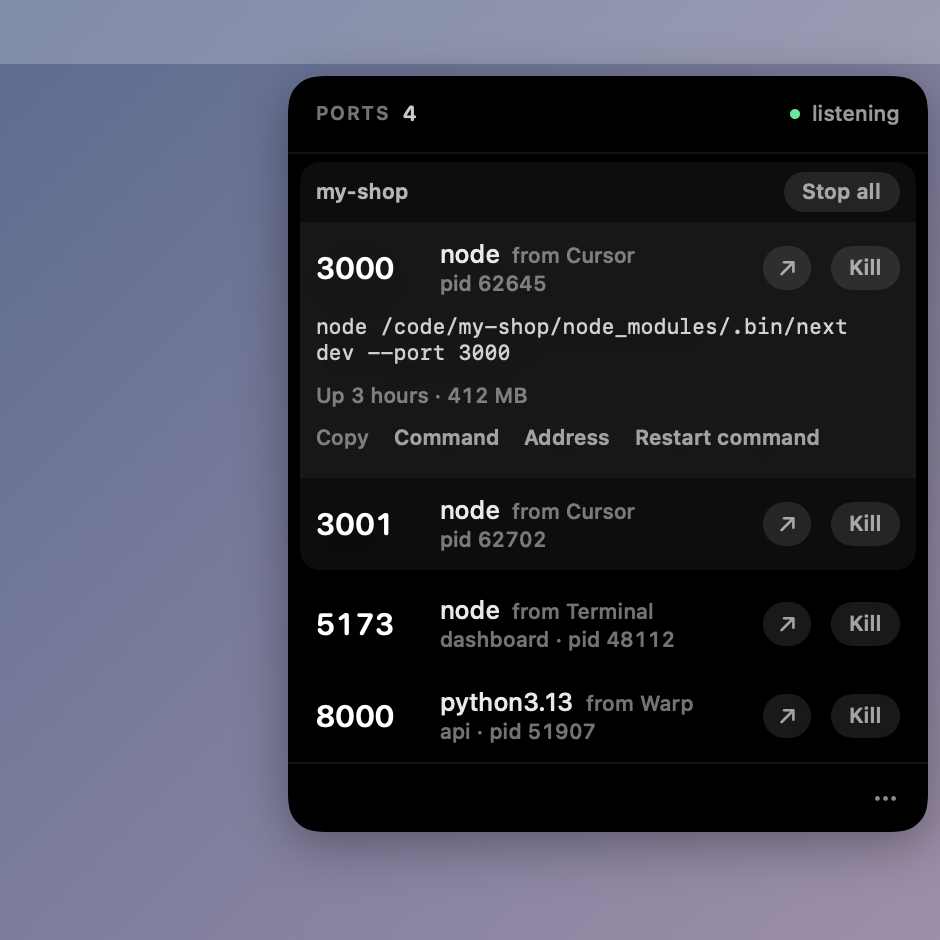
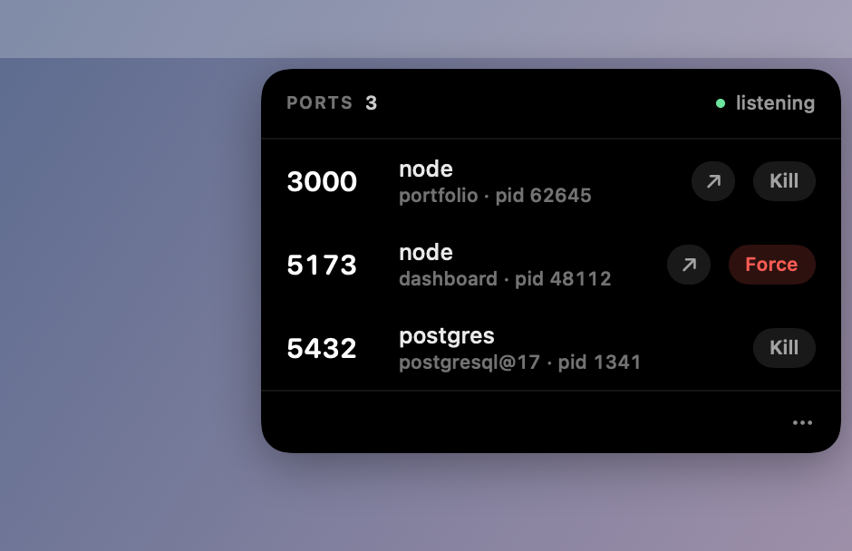
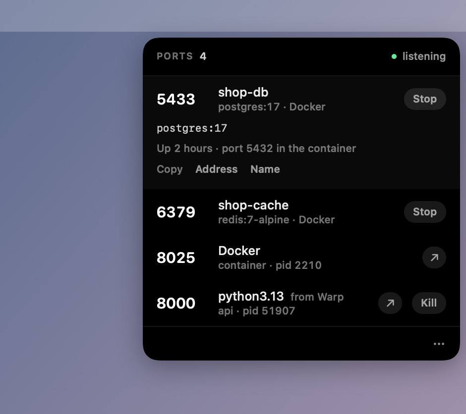

<p align="center">
  
</p>

<h1 align="center">Portpeek</h1>

<p align="center">
  See what is listening on your ports, from a corner of the screen.<br>
  Push the pointer into the corner. Kill what should not be there.
</p>

<p align="center">
  <a href="https://github.com/BRIJRAJ-02/portpeek/actions/workflows/ci.yml"></a>
  
  
  
</p>

<p align="center">
  
</p>

## What it does

`Error: listen EADDRINUSE: address already in use :::3000`. Then a search for the `lsof` incantation, a PID, a `kill`. Portpeek is that, without the terminal.

- **Lives in a corner.** Any of the four. Push the pointer into it and the list opens; move away and it closes.
- **Says whose port it is.** Each row shows the port, the process, and the folder it was started in, so two `node` servers read as `portfolio` and `dashboard`.
- **Says where it came from.** *from Cursor*, *from Terminal*: the app the server was started in. Click it and that app comes forward. For Terminal and iTerm2, so does the right tab.
- **Keeps a project together.** Two or more ports from the same folder sit under the folder's name, with *Stop all* for the lot.
- **Kills in one click.** *Kill* asks the process to quit. If it is still there a couple of seconds later, the button becomes *Force*.
- **Opens in the browser.** One click to `localhost:<port>`, offered for everything except databases and caches.
- **Shows the details.** Click a row for the full command line, how long it has been up and how much memory it holds, with the command and the address ready to copy.
- **Hands you the restart.** *Restart command* copies `cd <folder> && <command>`, so the server is one paste from coming back. Portpeek never restarts anything itself.
- **Knows a container from Docker.** A port published by Docker, OrbStack, Colima or Podman is shown as the container and its image, and *Stop* stops that container, not the runtime.
- **Works from the terminal.** `portpeek` lists the same ports, `portpeek 3000` says who holds one, `portpeek kill 3000` frees it.
- **Hides the noise.** AirPlay, Handoff and app helpers on random ports are tucked behind *Show in the background*.
- **Costs nothing while closed.** No menu bar icon, no Dock icon, and it only scans while the panel is open.

<p align="center">
  
</p>

## Install

### Download

Get `Portpeek-x.y.z.dmg` from the [latest release](https://github.com/BRIJRAJ-02/portpeek/releases/latest), open it and drag Portpeek to Applications. It runs on Apple Silicon and Intel, macOS 14 or later.

The app is not notarized, so macOS blocks the first launch. Either allow it under System Settings → Privacy & Security → Open Anyway, or run:

```bash
xattr -dr com.apple.quarantine /Applications/Portpeek.app
```

### Build from source

Requires Xcode 16 or later (for the Swift toolchain).

```bash
git clone https://github.com/BRIJRAJ-02/portpeek.git
cd portpeek
./scripts/build-app.sh --install   # builds, copies Portpeek.app to /Applications, launches it, links the portpeek command
```

### The command line tool

The `portpeek` command ships inside the app. Building with `--install` links it for you, as `/usr/local/bin/portpeek` or, if that is not writable, `~/.local/bin/portpeek`. After a download, link it yourself:

```bash
ln -sf /Applications/Portpeek.app/Contents/Resources/portpeek-cli /usr/local/bin/portpeek
```

## Using it

| Do this | To |
|---|---|
| Push the pointer into the corner | Open the list |
| Move away | Close it |
| Click the arrow | Open `localhost:<port>` in the browser |
| Click a row | Show its command line, uptime and memory. Click again to close |
| Click *Command*, *Address* or *Restart command* in an open row | Copy the command line, `http://localhost:<port>`, or `cd <folder> && <command>` |
| Click *Kill* | Ask the process to quit |
| Click *Force* | Stop a process that ignored *Kill* |
| Click *Stop* on a container | Stop that container and leave the runtime running |
| Click *Stop all* | Ask every process in that project to quit |
| Click *from Cursor* | Bring the app the server was started from to the front |
| Click *Show … in the background* | Include system services and app helpers |
| Right-click a row | Copy `localhost:3000` or the full URL, and see how long it has been up |
| Right-click the panel, or click ⋯ | Corner, Show Background Ports, Launch at Login, Quit |
| Open Portpeek again from Spotlight | Show the panel, if you forget which corner it is in |

It starts in the top right corner. If you use a macOS Hot Corner there, pick a different corner for one of them.

The panel sits clear of the menu bar and the Dock. With more than one display, the same corner works on each.

Services managed by Homebrew or launchd, such as Postgres, are restarted by their manager after you kill them. Stop those with `brew services stop`.

### Where it was started

Portpeek walks up from the server through its parent processes until it finds an app it can name: Terminal, iTerm2, Warp, Ghostty, kitty, Alacritty, WezTerm, VS Code, Cursor, Zed, Xcode, the JetBrains IDEs or Docker. Any other app is named as it is. A server inside tmux, screen or Zellij says so. *detached* means nothing is left above it but launchd: either a service, or a server whose terminal has been closed.

The first time you click *from Terminal* or *from iTerm2*, macOS asks whether Portpeek may control that app. That is what lets it pick the tab. Say no and the app still comes forward, just not the tab.

### Projects

A project is a folder with two or more ports in it. *Stop all* asks each of its processes to quit, the same way *Kill* does, and any that ignore it get their own *Force* button. It only ever reaches processes running in exactly that folder. System services, apps and their helpers are never part of a project, whatever folder they are in.

<p align="center">
  
</p>

### Details and restarting

Click a row, anywhere but its buttons, and it opens: the command line of the process holding the port, how long it has been running, and its memory. A very long command is cut off after three lines; *Command* still copies all of it.

*Restart command* copies `cd <folder> && <command>`. The command is the one that started the server, not always the process holding the port: `npm run dev` starts a shell, which starts `node`, which may rename itself `next-server`. Portpeek walks back up to what was typed into the terminal, or what the editor ran, and uses that. It is offered whenever a command and a folder are known, and never for apps, system services or containers.

Two things it cannot know: environment variables set on the command line, and quotes around an argument with spaces in it. Read the command before running it.

<p align="center">
  
</p>

### Containers

A port published by a container is held on the Mac by the runtime, not by the server inside. Portpeek recognises the listeners of Docker Desktop, OrbStack, Colima, Lima and Podman. When one is in the list it runs `docker ps` (or `podman ps`) to find which container published the port, and shows the container's name and image in place of `com.docker.backend`.

*Stop* on such a row runs `docker stop` for that one container. The runtime is never signalled, by *Kill*, by *Stop all* or by `portpeek kill`, because that would take every container down with it.

If the tool is not installed, does not answer within two seconds, or lists no container for the port, the row says *container*, names the runtime, and offers nothing destructive. Lima on its own always reads that way. So does a port forwarded from an OrbStack Linux machine.

<p align="center">
  
</p>

## Command line

```
$ portpeek
 PORT  PROCESS                PROJECT    ORIGIN      PID
 3000  node                   my-shop    Cursor    62645
 3001  node                   my-shop    Cursor    62702
 5173  node                   dashboard  Terminal  48112
 5433  shop-db (postgres:17)  -          Docker     2210
 8000  python3.13             api        Warp      51907

$ portpeek 3000
Port 3000 is held by node (pid 62645)
  project    my-shop
  folder     /code/my-shop
  origin     Cursor
  command    node /code/my-shop/node_modules/.bin/next dev --port 3000
  running    3 hours
  memory     412 MB
  restart    cd /code/my-shop && npm run dev
  address    http://localhost:3000

$ portpeek kill 3000
Port 3000 is free. node (pid 62645) quit.
```

| Command | Does |
|---|---|
| `portpeek` | List listening ports. `--all` includes system services and app helpers |
| `portpeek 3000` | Say what holds the port. `:3000` and `localhost:3000` work too |
| `portpeek kill 3000` | Ask it to quit, wait up to two seconds, and say whether the port was freed |
| `portpeek kill 3000 --force` | The same, then stop it outright if it is still there |
| `portpeek --json`, `portpeek 3000 --json` | The same facts as JSON. A fact that is not known is left out |

`kill` on a container's port stops that container. On a runtime's port with no known container it does nothing and says why.

| Exit code | Means |
|---|---|
| 0 | Done. For `kill`, the port is free |
| 1 | Nothing is listening on that port |
| 2 | The arguments made no sense |
| 3 | The port is still taken: the process ignored the request, or something started it again |
| 4 | Refused: the process belongs to someone else, or it is a container runtime |

```bash
portpeek 3000 >/dev/null || npm run dev               # start it only if nothing is there
portpeek --json | jq -r '.[] | "\(.port) \(.name)"'
```

## Design notes

- **A corner is the largest target on a screen.** The pointer cannot overshoot it, so there is nothing to aim at.
- **Nothing until asked.** No icon, no badge, no window. The panel grows out of the corner it lives in and shrinks back into it.
- **A beat before opening.** A pointer thrown at the corner on its way somewhere else does not trigger it.
- **Polite first.** *Kill* sends SIGTERM so servers can clean up. SIGKILL is offered only after that has failed.
- **Stop all cannot wander.** The list of what it stops is worked out again from the latest scan at the moment of the click, by one tested rule.
- **Second facts stay quiet.** Where a server came from is small and grey until the pointer is on it. The command line, uptime and memory do not fit on a row without crowding it, so they wait behind a click.
- **One row open at a time.** Opening another closes the first, and the panel always comes back as the plain list.
- **Nothing it cannot take back gets a button.** A runtime whose container is not known has no *Kill*. A restart is a line on the clipboard, not something done for you.
- **Color means something.** Green is listening. Red is the destructive button, and only under the pointer.
- **Numbers that hold still.** Ports and PIDs use tabular digits.
- **Click-through.** The window ignores the mouse everywhere outside the visible panel.

## How it is built

```
Sources/
  PortpeekCore/   UI-free scanner: parses lsof, ps and docker ps, classifies entries, finds who started them, groups projects, sends signals, and words everything the command line says
  Portpeek/       the panel: corner tracking, window placement, SwiftUI views
  portpeek-cli/   the portpeek command: a few lines over PortpeekCore
Tests/            parsing, classification, parent chains from fixture ps output, docker ps output, the Stop all rule, arguments and exit codes, a real listening socket, real processes being stopped
scripts/          build-app.sh bundles the app and the DMG; make-icon.swift draws the icon in code
```

Where the list comes from:

| Reading | Source |
|---|---|
| Listening sockets | `lsof -iTCP -sTCP:LISTEN` |
| Project folder | each process's working directory, from `lsof -d cwd` |
| App and system detection | the executable path, from `ps` |
| Where it was started, and for how long | parent, terminal and elapsed time of every process, from the same single `ps` call |
| Command line and memory | `args` and `rss` of every process, from a second `ps` call |
| What to run to restart it | the outermost command between the server and the shell or app above it |
| Containers | `docker ps` or `podman ps`, only when a runtime is holding a port |
| The terminal tab | the tab whose tty matches, asked for over AppleScript, only on click |

Portpeek sees the processes your user owns, which is what a dev machine runs. Listing and stopping need no special permissions. Picking a Terminal or iTerm2 tab needs Automation permission, which macOS asks for the first time you use it. Nothing leaves your Mac.

### Developing

```bash
swift build && swift test       # or open Package.swift in Xcode
./scripts/build-app.sh --open   # build and launch the app bundle
./scripts/build-app.sh --dmg    # universal build, packaged as build/Portpeek-<version>.dmg
.build/debug/Portpeek --snapshot docs   # re-render the README screenshots with sample data
.build/debug/Portpeek --snapshot /tmp/portpeek --checks   # also render the awkward cases: long names, long commands, a project mid-stop
.build/debug/portpeek-cli --json   # the command line tool, straight from the build folder
```

## License

[MIT](LICENSE)
