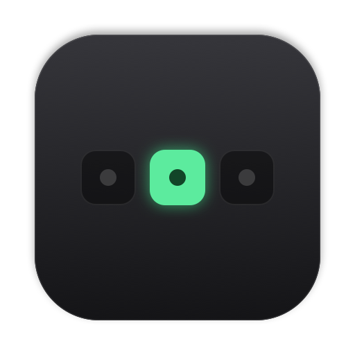
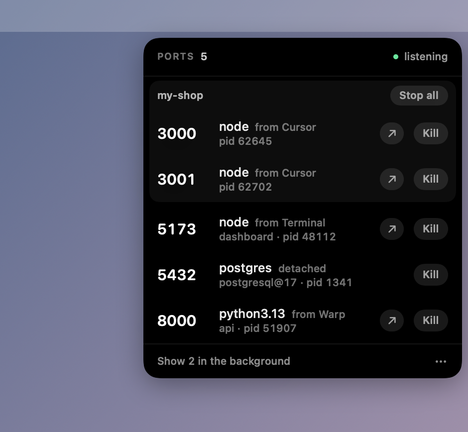
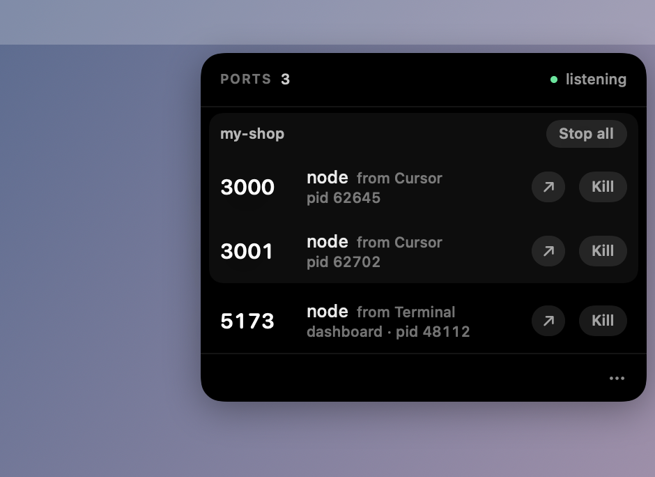

<p align="center">
  
</p>

<h1 align="center">Portpeek</h1>

<p align="center">
  See what is listening on your ports, from a corner of the screen.<br>
  Push the pointer into the corner. Kill what should not be there.
</p>

<p align="center">
  <a href="https://github.com/BRIJRAJ-02/portpeek/actions/workflows/ci.yml"></a>
  
  
  
</p>

<p align="center">
  
</p>

## What it does

`Error: listen EADDRINUSE: address already in use :::3000`. Then a search for the `lsof` incantation, a PID, a `kill`. Portpeek is that, without the terminal.

- **Lives in a corner.** Any of the four. Push the pointer into it and the list opens; move away and it closes.
- **Says whose port it is.** Each row shows the port, the process, and the folder it was started in, so two `node` servers read as `portfolio` and `dashboard`.
- **Says where it came from.** *from Cursor*, *from Terminal*: the app the server was started in. Click it and that app comes forward. For Terminal and iTerm2, so does the right tab.
- **Keeps a project together.** Two or more ports from the same folder sit under the folder's name, with *Stop all* for the lot.
- **Kills in one click.** *Kill* asks the process to quit. If it is still there a couple of seconds later, the button becomes *Force*.
- **Opens in the browser.** One click to `localhost:<port>`, offered for everything except databases and caches.
- **Hides the noise.** AirPlay, Handoff and app helpers on random ports are tucked behind *Show in the background*.
- **Costs nothing while closed.** No menu bar icon, no Dock icon, and it only scans while the panel is open.

<p align="center">
  
</p>

## Install

### Download

Get `Portpeek-x.y.z.dmg` from the [latest release](https://github.com/BRIJRAJ-02/portpeek/releases/latest), open it and drag Portpeek to Applications. It runs on Apple Silicon and Intel, macOS 14 or later.

The app is not notarized, so macOS blocks the first launch. Either allow it under System Settings → Privacy & Security → Open Anyway, or run:

```bash
xattr -dr com.apple.quarantine /Applications/Portpeek.app
```

### Build from source

Requires Xcode 16 or later (for the Swift toolchain).

```bash
git clone https://github.com/BRIJRAJ-02/portpeek.git
cd portpeek
./scripts/build-app.sh --install   # builds, copies Portpeek.app to /Applications, launches it
```

## Using it

| Do this | To |
|---|---|
| Push the pointer into the corner | Open the list |
| Move away | Close it |
| Click the arrow | Open `localhost:<port>` in the browser |
| Click *Kill* | Ask the process to quit |
| Click *Force* | Stop a process that ignored *Kill* |
| Click *Stop all* | Ask every process in that project to quit |
| Click *from Cursor* | Bring the app the server was started from to the front |
| Click *Show … in the background* | Include system services and app helpers |
| Right-click a row | Copy `localhost:3000` or the full URL, and see how long it has been up |
| Right-click the panel, or click ⋯ | Corner, Show Background Ports, Launch at Login, Quit |
| Open Portpeek again from Spotlight | Show the panel, if you forget which corner it is in |

It starts in the top right corner. If you use a macOS Hot Corner there, pick a different corner for one of them.

The panel sits clear of the menu bar and the Dock. With more than one display, the same corner works on each.

Services managed by Homebrew or launchd, such as Postgres, are restarted by their manager after you kill them. Stop those with `brew services stop`.

### Where it was started

Portpeek walks up from the server through its parent processes until it finds an app it can name: Terminal, iTerm2, Warp, Ghostty, kitty, Alacritty, WezTerm, VS Code, Cursor, Zed, Xcode, the JetBrains IDEs or Docker. Any other app is named as it is. A server inside tmux, screen or Zellij says so. *detached* means nothing is left above it but launchd: either a service, or a server whose terminal has been closed.

The first time you click *from Terminal* or *from iTerm2*, macOS asks whether Portpeek may control that app. That is what lets it pick the tab. Say no and the app still comes forward, just not the tab.

### Projects

A project is a folder with two or more ports in it. *Stop all* asks each of its processes to quit, the same way *Kill* does, and any that ignore it get their own *Force* button. It only ever reaches processes running in exactly that folder. System services, apps and their helpers are never part of a project, whatever folder they are in.

<p align="center">
  
</p>

## Design notes

- **A corner is the largest target on a screen.** The pointer cannot overshoot it, so there is nothing to aim at.
- **Nothing until asked.** No icon, no badge, no window. The panel grows out of the corner it lives in and shrinks back into it.
- **A beat before opening.** A pointer thrown at the corner on its way somewhere else does not trigger it.
- **Polite first.** *Kill* sends SIGTERM so servers can clean up. SIGKILL is offered only after that has failed.
- **Stop all cannot wander.** The list of what it stops is worked out again from the latest scan at the moment of the click, by one tested rule.
- **Second facts stay quiet.** Where a server came from is small and grey until the pointer is on it. How long it has been up did not fit on the row without crowding it, so it lives in the right-click menu.
- **Color means something.** Green is listening. Red is the destructive button, and only under the pointer.
- **Numbers that hold still.** Ports and PIDs use tabular digits.
- **Click-through.** The window ignores the mouse everywhere outside the visible panel.

## How it is built

```
Sources/
  PortpeekCore/   UI-free scanner: parses lsof and ps, classifies entries, finds who started them, groups projects, sends signals
  Portpeek/       the panel: corner tracking, window placement, SwiftUI views
Tests/            parsing, classification, parent chains from fixture ps output, the Stop all rule, a real listening socket, real processes being stopped
scripts/          build-app.sh bundles the app and the DMG; make-icon.swift draws the icon in code
```

Where the list comes from:

| Reading | Source |
|---|---|
| Listening sockets | `lsof -iTCP -sTCP:LISTEN` |
| Project folder | each process's working directory, from `lsof -d cwd` |
| App and system detection | the executable path, from `ps` |
| Where it was started, and for how long | parent, terminal and elapsed time of every process, from the same single `ps` call |
| The terminal tab | the tab whose tty matches, asked for over AppleScript, only on click |

Portpeek sees the processes your user owns, which is what a dev machine runs. Listing and stopping need no special permissions. Picking a Terminal or iTerm2 tab needs Automation permission, which macOS asks for the first time you use it. Nothing leaves your Mac.

### Developing

```bash
swift build && swift test       # or open Package.swift in Xcode
./scripts/build-app.sh --open   # build and launch the app bundle
./scripts/build-app.sh --dmg    # universal build, packaged as build/Portpeek-<version>.dmg
.build/debug/Portpeek --snapshot docs   # re-render the README screenshots with sample data
.build/debug/Portpeek --snapshot /tmp/portpeek --checks   # also render the awkward cases: long names, a project mid-stop
```

## License

[MIT](LICENSE)
